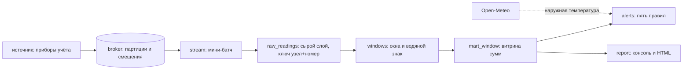

# teplo-stream — поток телеметрии теплосети

Приборы учёта в тепловых пунктах шлют показания каждые полминуты: температура подачи и обратки, расход, давление. Конвейер складывает эти события в очередь, каждые несколько минут разбирает накопившуюся пачку, сворачивает её в пятиминутные окна и обновляет витрину. Поверх витрины работают пять правил: они находят утечку, перетоп, недотоп и пропавший узел раньше, чем об этом позвонят жильцы.

Ни Kafka, ни Spark, ни Docker: очередь — файлы на диске, хранилище — один файл DuckDB. Разворачивается в одну команду и работает на ноутбуке.

```text
$ teplo demo --minutes 60

Телеметрия: 558 показаний, в очередь пришло 570 (повторы и опоздания — часть сценария).

На улице 10.1 °C (сеть, 01:30) — по графику подача должна быть около 60.0 °C.

Узел            Окно   Показаний  кВт·ч    м³  Подача  Обратка  Перепад  Давление  Поздних
ИТП-Гагарина-5  01:35         10    8.5  0.37    50.7     30.7     20.0      5.56        0
ИТП-Заречная-8  01:15          8    6.8  0.26    60.1     37.4     22.7      5.57        0
ИТП-Ленина-14   01:35         10    9.4  0.35    60.2     37.1     23.1      5.58        0
ИТП-Мира-27     01:35         10    3.6  0.43    59.8     52.5      7.3      5.56        0
ИТП-Садовая-3   01:35         10   13.4  0.55    60.2     39.2     21.0      3.95        0

! ИТП-Заречная-8: нет показаний 20 мин (последнее окно 01:15)
! ИТП-Садовая-3: расход 0.55 м³ за окно — в 1.8 раза больше обычных 0.30 м³
! ИТП-Садовая-3: давление упало до 3.95 бар (порог 4.0)
· ИТП-Гагарина-5: подача 50.7 °C при норме 60.0 °C для улицы 10.1 °C
· ИТП-Мира-27: перепад 7.3 °C (подача 59.8, обратка 52.5) — тепло уходит обратно в сеть

Витрина: узлов 5, окон 56, показаний 558, опоздавших 13, тепла 430.0 кВт·ч.

Проходы конвейера:
№  Время  Прочитано  Записано  Повторов  Окон  Поздних  Секунд
1  01:44         95        92         3    10        0    0.83
2  01:44         95        94         1    16        2    0.92
3  01:44         95        95         0    16        1    0.92
4  01:44         95        94         1    17        2    1.28
5  01:44         95        90         5    16        3    0.89
6  01:44         95        93         2    17        5    0.92
```

В этих цифрах и есть смысл конвейера: из 570 пришедших событий 12 оказались повторами и в витрину не попали, а 13 показаний опоздали — их окна успели закрыться, и они были досчитаны задним числом, а не выброшены и не приписаны к моменту доставки.

## Что внутри

| Свойство | Как сделано |
|---|---|
| Очередь | топик — папка, партиция — файл, смещение — номер строки; партиция выбирается устойчивым хешем ключа, у каждой группы свои смещения |
| Мини-батч | прочитать пачку → разобрать → записать → свернуть в окна → обновить витрину → сдвинуть смещение |
| Ровно один раз | у сырого слоя первичный ключ «узел + номер показания»; `RETURNING` отдаёт только действительно вставленные строки, и досчитывают витрину именно они |
| Безопасный перезапуск | смещение коммитится после записи: падение между шагами приводит к повторному чтению, а не к потере |
| Окна и водяной знак | показание попадает в окно по времени измерения; окно закрывается, когда поток ушёл вперёд на две минуты; опоздавшее показание досчитывается в закрытое окно и считается отдельно |
| Витрина | хранит суммы, а не средние: среднее нельзя досчитать, а сумму — можно |
| Битые события | считаются, попадают в отчёт и пропускаются: одно кривое сообщение не должно останавливать поток |
| Правила | нет связи, недотоп, малый перепад, возможная утечка, низкое давление |
| Наружная температура | Open-Meteo с кешем на диске; нет ответа — правило, зависящее от улицы, молчит, остальное работает |
| Отчёт | таблицы в консоль и самодостаточная HTML-страница со столбиками тепла по окнам |

## Как запустить

```bash
uv sync
uv run teplo demo                                  # весь путь сразу: поток, витрина, аварии, страница
uv run teplo produce --root стенд --minutes 60     # сгенерировать телеметрию и положить в очередь
uv run teplo run --root стенд                      # обработать очередь мини-батчами
uv run teplo report --root стенд --html отчёт.html  # отчёт и страница
uv run teplo alerts --root стенд                   # только аварии; код возврата 1, если есть авария
uv run teplo meteo                                 # проверить источник наружной температуры
```

`teplo alerts` возвращает 1 при аварии — этого достаточно, чтобы повесить проверку в планировщик и получать письмо, не написав ни строчки дополнительного кода:

```bat
schtasks /create /tn "Теплосеть" /tr "teplo alerts --root C:\стенд" /sc minute /mo 5
```

Тот же конвейер вызывается из Airflow, если он в хозяйстве уже есть. Этот кусок я не запускал — Airflow на машине нет:

```python
with DAG("teplo", schedule="*/5 * * * *", catchup=False, start_date=datetime(2026, 2, 1, tzinfo=UTC)):
    PythonOperator(task_id="батч", python_callable=lambda: Pipeline(broker, warehouse).run_until_empty())
```

## Как устроено



| Модуль | Ответственность |
|---|---|
| `events.py` | схема показания в одном месте: проверка, перевод времени в UTC, расчёт тепла |
| `broker.py` | файловая очередь: партиции, чтение с последнего смещения, коммит группы |
| `windows.py` | пятиминутные окна, водяной знак, свёртка пачки |
| `warehouse.py` | DuckDB: сырой слой, витрина, состояние конвейера, журнал проходов |
| `stream.py` | порядок шагов мини-батча и учёт того, что случилось за проход |
| `alerts.py` | пять правил с порогами и понятными текстами |
| `meteo.py` | наружная температура и упрощённый температурный график |
| `source.py` | эмулятор узлов: норма, утечка, перетоп, недотоп, обрыв связи |
| `report.py`, `cli.py`, `demo.py` | отчёт, команды, демонстрация |

## Как проверялось

- `ruff format`, `ruff check` (E, F, W, I, B, UP, S — bandit, C4, SIM, PT, RUF, DTZ) и `mypy --strict` — без замечаний.
- `pytest` — 67 тестов за 15 с: схема события и его ошибки, часовые пояса, очередь (устойчивый хеш, честное деление пачки между партициями, коммит, испорченная строка), окна и водяной знак, хранилище (дедупликация, досчёт окон, медиана для правила утечки), конвейер (перезапуск после сбоя, битое событие, опоздавшее показание), все пять правил, клиент погоды на эмуляторе сети, команды.
- Проверка «повтор внутри одной пачки» нашла настоящую ошибку в моём же коде: одинаковые показания в одной пачке проходили дедупликацию и удваивали потребление в витрине. Исправлено, проверка осталась.
- Живой прогон 12.09.2026: 558 показаний, 570 событий в очереди, 12 повторов отсечено, 13 опоздавших досчитано, 56 окон, 430 кВт·ч. Наружная температура +10,1 °C получена из Open-Meteo по сети, без ключей и регистрации.
- Часовые пояса проверены отдельно: DuckDB кладёт в столбец `TIMESTAMP` время, пересчитанное в местное, поэтому пояс снимается явно. Без этого один и тот же поток на московском сервере и на владивостокском ноутбуке попал бы в разные окна — на это есть тест.
- Кодировка консоли: в стандартном окне Windows «м³» не печатается, вывод падал с `UnicodeEncodeError`. Командная строка теперь сама переключает поток вывода на UTF-8.

### Не проверялось

- Очередь учебная: один писатель, чтение партиции с начала файла, без сегментов, сжатия и удаления старого. На нагрузке, на нескольких писателях и на многогигабайтных топиках не проверялась.
- Настоящие Kafka, Spark и Airflow не поднимались. Пример DAG в этом README не запускался.
- Телеметрия синтетическая: приборов учёта у меня нет. Пороги правил (перепад 10 °C, давление 4 бар, график 95/70) — прикидка для демонстрации, а не норматив теплосети; в реальном внедрении их задаёт эксплуатирующая организация.
- Объём: сотни событий и десятки окон. Миллионы строк, рост файла DuckDB и время запросов на больших данных не проверялись.
- HTML-страница проверена программно (заголовок, разделы, SVG, имена узлов), но в браузере я её не открывал: Playwright на этой машине не нашёл Chrome, а ставить браузер ради одного снимка я не стал.
- Правило «возможная утечка» сравнивает объём с медианой прошлых окон и на длинной аварии перестанет срабатывать, когда повышенный расход сам станет нормой. Поведение на многодневной истории не проверялось.

## Структура

```text
src/teplo/   events, broker, windows, warehouse, stream, alerts, meteo, source, report, demo, cli
tests/       события, очередь, окна, хранилище, конвейер, правила, погода, команды
examples/    дашборд.html — страница из живого прогона
```
